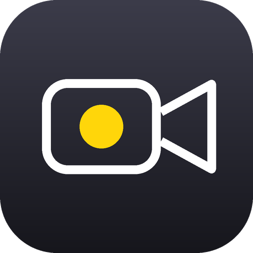
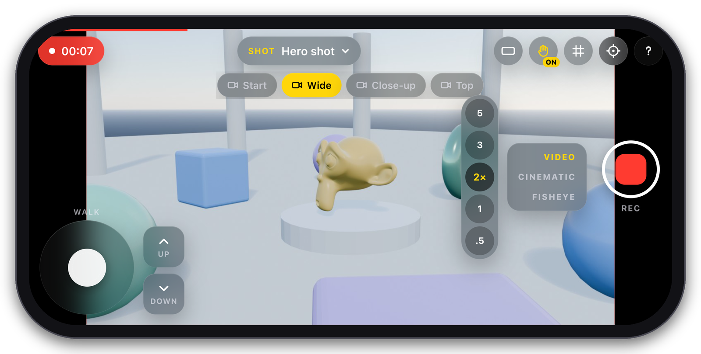
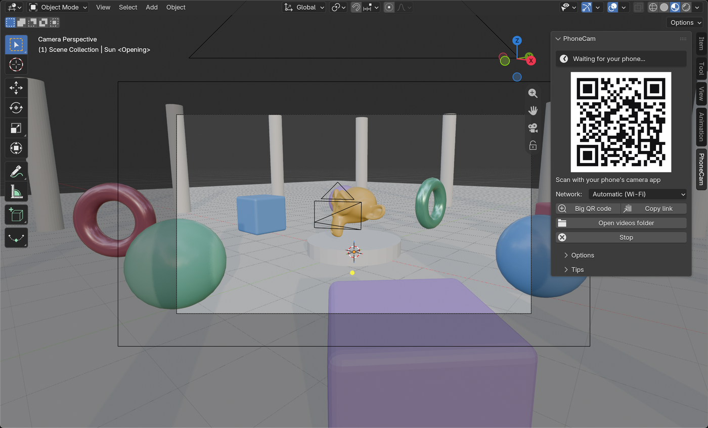
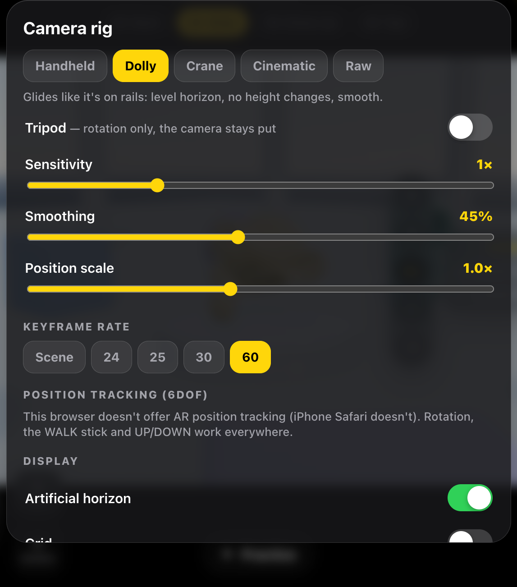

<h1 align="center">PhoneCam — turn your phone into a camera for Blender</h1>

<b>Free, open-source Blender add-on: use your iPhone or Android phone as a handheld virtual camera.</b> 
Point your phone to aim, walk, zoom like the iPhone camera, and record smooth camera moves straight into Blender — saved as MP4.

  
  

  
  
  
  
  

---

## Why PhoneCam?

Keyframing a camera by hand looks robotic. A real handheld camera has life: tiny shakes, natural pans, a zoom that eases in.
**PhoneCam lets you film your Blender scene like you would film real life** — with the phone you already own.

- 📱 **No app to install** — it runs in Safari or Chrome. Just scan a QR code.
- 🎥 **Your phone is the camera** — tilt and turn the phone to aim, the on-screen stick walks the camera, ▲▼ moves it up and down.
- 🔍 **iPhone-style zoom** — `.5 · 1× · 2 · 3 · 5` lens buttons that glide smoothly, pinch to zoom, or slide along the lens buttons like a zoom dial.
- 🎬 **Three looks** — **Video**, **Cinematic** (shallow depth of field with autofocus and tap-to-focus), **Fisheye** (super wide, curved edges).
- ✋ **Stabilizer** — On, Action (gimbal-smooth) or Off for raw handheld.
- 📐 **Wide 16:9 or vertical 9:16** — perfect for YouTube *and* Reels, TikTok, Shorts.
- ⏺️ **Record → review → save** — watch your take on the phone, then *Save* or *Retake*. The MP4 lands in your Videos folder.
- 🧈 **Smooth by design** — PhoneCam records the full-speed phone motion and rebuilds the camera path, so a heavy scene can never make your take stutter. Motion blur included.
- 🎯 **Uses your scene** — timeline **markers** become *shots*; every **camera** in the scene becomes a one-tap *camera spot*.
- 🚗 **Ride along** — film from inside a moving car, horse or spaceship.
- 🎛️ **Rig presets** — **Handheld, Dolly, Crane, Cinematic, Raw**, plus **Tripod** (rotation only).
- 🎚️ **Live sliders** — **Sensitivity**, **Smoothing** and **Position scale**, right on the phone.
- 🧭 **6DoF position tracking** — walk around for real with AR tracking (Android Chrome / WebXR browsers).
- ⏱️ **Keyframes at 24, 25, 30 or 60 fps** (or your scene's rate), sub-frame accurate.
- ✈️ **Artificial horizon** — pitch ladder and roll, turns yellow when you're level.
- ✅ **Preflight check** in Blender — address, ports, 3D Viewport, camera, fps, ffmpeg, latency, with one-click fixes.
- 🪄 **Smooth Keyframes** and **Bake to World camera** tools for your takes.
- ⚡ **Low latency** — a WebSocket link (with automatic HTTP fallback) and a live latency readout.
- 🔒 **Private** — phone and computer talk directly over your own Wi-Fi. No account, no cloud, no internet needed, no tracking.
- 💸 **Free forever** — open source (GPL-3.0). No ads, no subscription, no watermark.

## Quick start (3 minutes)

1. **Install** — download [`phonecam-1.1.0.zip`](https://github.com/doo5tet/PhoneCam/releases/latest) and drag it into Blender (4.2 or newer).
2. **Start** — in the 3D Viewport press **N**, open the **PhoneCam** tab, click **Start PhoneCam**.
3. **Scan** — point your phone's Camera app at the QR code. The first time, follow the 1-minute setup on the phone. Done — film!

## Install in Blender

PhoneCam is a Blender **extension** (Blender 4.2, 4.3, 4.4, 4.5, 5.x).

1. Download **`phonecam-1.1.0.zip`** from [Releases](https://github.com/doo5tet/PhoneCam/releases/latest). Don't unzip it.
2. Either **drag the zip into the Blender window**, or go to **Edit → Preferences → Get Extensions → ⌄ (top right) → Install from Disk…** and pick the zip.
3. Make sure **PhoneCam** is ticked. That's it.

> Your computer may ask whether Blender may accept incoming network connections. Click **Allow** — that is how your phone reaches Blender over Wi-Fi.

## Connect your phone

Your phone and computer must be on the **same Wi-Fi** (a phone hotspot works too).

1. In Blender: **N** → **PhoneCam** → **Start PhoneCam**. A QR code appears.
2. On the phone: open the **Camera** app and scan the QR code, then open the link.
3. **First time only** — phones give motion sensors only to secure pages, so the phone needs to trust your own computer once. The page walks you through it:

<b>iPhone / iPad</b>

1. Tap **Download certificate** → **Allow** → **Close**.
2. Open **Settings** → **Profile Downloaded** → **Install** (passcode) → **Install** → **Done**.
3. **Settings → General → About → Certificate Trust Settings** → switch on **PhoneCam on …** (your computer) → **Continue**.
4. Go back to Safari — the page notices and opens the camera by itself.

<b>Android</b>

1. Tap **Download certificate**.
2. Open **Settings**, search **“CA certificate”** → **Install a certificate → CA certificate → Install anyway** → pick **PhoneCam-CA.crt**.
3. Go back to Chrome — the camera opens by itself.

Next time, just scan and film. Tip: **Share → Add to Home Screen** turns PhoneCam into a full-screen app icon.

## How to film

| Do this | To |
|---|---|
| Move / tilt your phone | Aim the camera |
| **WALK** stick | Move forward, back, left, right |
| **UP / DOWN** | Raise or lower the camera |
| `.5` `1×` `2` `3` `5` | Glide to a lens (like the iPhone) |
| Pinch the picture · slide along the lens buttons | Smooth zoom |
| **VIDEO / CINEMATIC / FISHEYE** | Change the look |
| Tap the picture (Cinematic) | Choose what is sharp |
| **⊙** | Reset aim to where your phone points |
| **▭ / ▯** | Wide 16:9 or vertical 9:16 |
| ✋ | Stabilizer: On → Action → Off |
| **⚙** | Rig preset, Tripod, Sensitivity / Smoothing / Position scale, keyframe rate, AR tracking, horizon, grid |
| **Practice** | Rehearse the shot without recording |
| 🔴 | Record. Then **Watch**, **Retake** or **Save video** |

**Shots** — add timeline markers in Blender (`M` in the timeline) and each marker becomes a shot you can pick on the phone. No markers? The whole timeline is one shot.
**Camera spots** — every camera in your scene appears as a button at the top of the phone screen; tap to jump there.
**Your takes** are also kept in Blender as keyframes on the `PhoneCam` camera, so you can tweak them later. In **N → PhoneCam → Takes**, **Smooth keyframes** irons out a take and **Bake to World camera** saves it as its own camera, so new takes never overwrite it.

### Rig presets

| Preset | Feels like |
|---|---|
| **Handheld** | Natural hand-held camera with light smoothing |
| **Dolly** | On rails: level horizon, no height changes, smooth |
| **Crane** | Big smooth vertical moves (UP/DOWN and AR height ×2), level horizon |
| **Cinematic** | Very smooth and level, like a gimbal |
| **Raw** | Exactly what your hand does, no smoothing |
| **Tripod** (switch) | Rotation only — the camera stays where it is |

### 6DoF position tracking

On phones whose browser supports WebXR AR (e.g. **Android Chrome**), tap **⚙ → Start AR tracking**: the camera now follows your phone's real position as you walk around the room. **Position scale** sets how far it travels (0.05× to 50×). iPhone Safari doesn't offer AR tracking to web pages, so on iPhone you aim by moving the phone and travel with the WALK stick and UP/DOWN.

## Settings

**N → PhoneCam → Options**, or *Preferences → Add-ons → PhoneCam*:

- **Save videos to** — default `Movies/PhoneCam` (macOS) or `Videos/PhoneCam` (Windows/Linux).
- **Video size** — 720p (fast) or 1080p (sharp). Saved with your scene's own render engine (EEVEE, Cycles…).
- **Motion blur**, **Walk speed**, **Ride along with** (an object the camera travels with).
- **Ports** — 8765 (camera) and 8766 (setup) by default.

## Troubleshooting

Start with **N → PhoneCam → Preflight check**: it shows ✓ or ⚠ for the Wi-Fi address, the phone link, the 3D Viewport, the camera, frame rate, ffmpeg and latency — with a **Fix** button where it can help.

- **No QR code / no preview** — the live preview is drawn from a **3D Viewport**: make sure one is open (the Preflight check's **Fix** button switches to the Layout workspace).
- **The QR link doesn't open / “can't connect”** — phone and computer must be on the same Wi-Fi. Some café, school and guest networks block devices from seeing each other; use your phone's hotspot instead. Allow Blender in your firewall.
- **Safari says “This connection is not private”** — finish the one-time certificate step, including *Certificate Trust Settings*.
- **The picture is sideways or the controls won't turn** — turn off the phone's rotation lock, or pick *Vertical video*.
- **Fisheye is greyed out** — install [ffmpeg](https://ffmpeg.org) (`brew install ffmpeg` on macOS, `winget install ffmpeg` on Windows, `sudo apt install ffmpeg` on Linux) and restart Blender.
- **The preview is slow** — big scenes draw slower. The *saved* video is always smooth; the preview is just for framing.
- **Port busy** — change the ports in Options, then Stop → Start.

## FAQ

**Is PhoneCam really free?** Yes. Free forever, open source under GPL-3.0. No ads, no account, no paid tier.

**Do I need to install an app on my phone?** No. It runs in Safari (iPhone) or Chrome (Android).

**Does it need the internet?** No. Your phone talks to Blender directly over your local Wi-Fi.

**Which phones work?** Any iPhone or Android phone with a gyroscope and a modern browser (iOS 13+, Android 8+).

**Which Blender versions?** Blender 4.2 and newer on macOS, Windows and Linux.

**Is it safe?** The connection is encrypted with a certificate your own computer makes, and the QR code carries a private pairing key, so other people on the same Wi-Fi can't take over your camera. Nothing leaves your network.

**Where are my videos?** In the folder shown under *Options* (click **Open videos folder** in the PhoneCam tab).

## How it works (for the curious)

Blender runs a tiny HTTPS server. The phone page reads the gyroscope (`DeviceOrientationEvent`), turns it into a quaternion and streams it to Blender ~50 times a second; Blender streams back a small live preview. While recording, PhoneCam stores the raw phone stream and rebuilds the camera path at 5× the frame rate with exact critically-damped smoothing, an optional Gaussian stabilizer, then keys one frame per frame and renders the take with your scene's render engine. The certificate authority and server certificate are generated in pure Python (no OpenSSL needed). Fisheye uses the same barrel-distortion numbers for the live preview (NumPy) and the final video (ffmpeg).

## Contributing

Bug reports, ideas and pull requests are welcome — open an [issue](https://github.com/doo5tet/PhoneCam/issues). Translations of the phone pages are especially welcome.

## License

PhoneCam is free software under the [GNU GPL v3.0 or later](LICENSE). It bundles the [segno](https://github.com/heuer/segno) QR code library (BSD-3-Clause).

Keywords: Blender phone camera, use phone as camera in Blender, Blender virtual camera, handheld camera Blender, iPhone camera tracking Blender, Android gyroscope camera, virtual production, camera motion capture, free Blender add-on, Blender extension.
